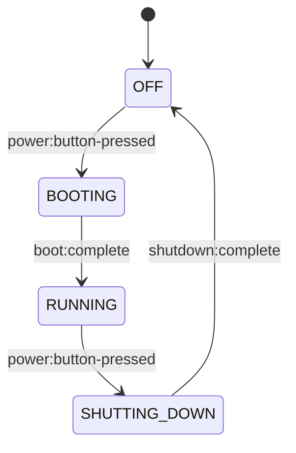
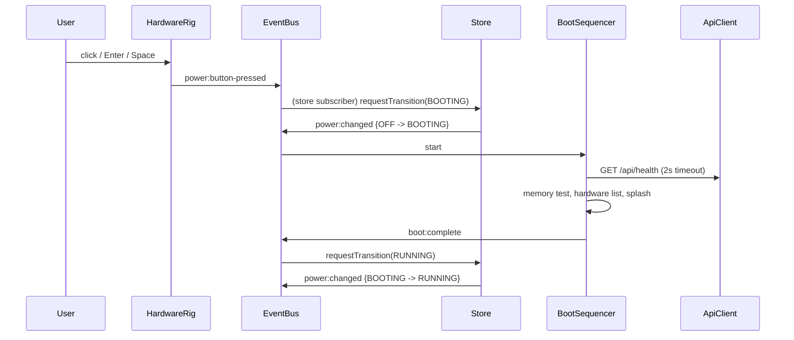

# Design Document

## Overview

Chronos 95 is a retro 1995-style CRT desktop rig and operating system. The Frontend is a static site in Vanilla HTML5, CSS3, and ES6 modules (`type="module"`), with no UI framework. The Backend is a Python 3.11+ FastAPI service that provides document persistence and the Chippy assistant, validated by Pydantic and shipped in Docker.

The design rests on one rule from the steering file: every hardware and OS transition flows through the Store (`frontend/js/core/store.js`) and the Event_Bus (`frontend/js/core/eventBus.js`). Components never touch each other's DOM. Applications are plugin modules mounted by the Window_Manager (`frontend/js/core/windowManager.js`).

Key design decisions:

- **Pure cores, thin shells.** Each component is split into a pure logic module (state machines, geometry, rasterizers, validators, formatters) and a thin DOM shell. Pure cores are property-tested. DOM shells get example tests. This is what makes property-based testing practical.
- **Store is the only writer of Power_State.** Components request transitions. The Store validates them against a transition table and publishes `power:changed` after the state update.
- **Event_Bus is synchronous and isolating.** A throwing subscriber is logged and never stops delivery. Subscribers are copied before dispatch so unsubscribe during dispatch is safe.
- **Injected collaborators.** Clock, timers, API client, and `Date` are injected so tests use fake timers and mocks. No test needs a real browser clock or network.
- **Backend layering.** Routers are thin. Pydantic models own validation. A `DocumentStore` protocol hides persistence. The `ChippyService` has a deterministic rule engine and an optional provider.
- **Trademark safety by tooling.** A scanner script enforces Requirement 13 and 14.8 in CI.

Research notes (summarized from established documentation, not newly fetched):

- FastAPI returns HTTP 422 with a per-field error list for Pydantic validation failures. That matches Requirement 11.9 with little custom code.
- Hypothesis `RuleBasedStateMachine` fits the Document_Store and CRUD lifecycle. Default `max_examples` is 100, which meets the 100-example floor, and it is set explicitly.
- On the Frontend, `fast-check` is the property-based library for JavaScript, run with Node's built-in `node:test` runner. This avoids a bundler or framework and stays in dev-only tooling, outside the shipped Frontend.
- Canvas `imageSmoothingEnabled = false` and `image-rendering: pixelated` are the standard way to keep pixel-exact output. Drawing algorithms operate on an in-memory `Uint8ClampedArray` buffer and write to the canvas with `putImageData`, which never anti-aliases.

## Architecture

```mermaid
flowchart LR
  subgraph Frontend [/frontend - ES modules]
    Rig[ui/hardwareRig.js] -- power:button-pressed --> Bus
    Store[core/store.js] -- power:changed --> Bus
    Bus((core/eventBus.js))
    Bus --> Boot[core/bootSequencer.js]
    Bus --> Shut[core/shutdownSequencer.js]
    Bus --> Shell[ui/osShell.js]
    Bus --> WM[core/windowManager.js]
    Shell --> Taskbar[ui/taskbar.js]
    Shell --> Chippy[ui/chippyWidget.js]
    WM -- mount/unmount --> Notepad[apps/notepadApp.js]
    WM -- mount/unmount --> Paint[apps/paintApp.js]
    Notepad --> Api[core/apiClient.js]
    Paint --> Api
    Chippy --> Api
    Boot --> Api
  end
  Api -- HTTP/JSON --> BE
  subgraph BE [/backend - FastAPI]
    Routers[app/routers] --> Models[app/models Pydantic]
    Routers --> DS[app/store DocumentStore]
    Routers --> CS[app/chippy ChippyService]
    DS --> Disk[(Document_Store volume)]
  end
```

### Power lifecycle



### Boot sequence



### Repository layout

```
frontend/
  index.html            (only <script type="module">)
  css/                  crt.css, shell.css, window.css, apps.css
  assets/               original icons and sounds only
  js/core/              eventBus.js store.js windowManager.js bootSequencer.js
                        shutdownSequencer.js apiClient.js powerRouter.js
  js/ui/                hardwareRig.js osShell.js taskbar.js startMenu.js
                        chippyWidget.js dialogs.js
  js/apps/              notepadApp.js paintApp.js (+ pure helpers)
  tests/                fast-check + node:test suites
backend/
  app/                  main.py config.py models.py store.py chippy.py routers/
  tests/                Hypothesis suites
  Dockerfile
docker-compose.yml  .env.example
tools/compliance_scan.py
```

## Components and Interfaces

### Event_Bus (`core/eventBus.js`)

```
subscribe(eventName: string, handler: (payload) => void): () => void   // returns unsubscribe
publish(eventName: string, payload?: any): void
```

- Delivery list is a snapshot taken at publish time, in subscription order.
- Handlers run inside try/catch. A failure logs `eventName` and the error, then delivery continues.
- Unsubscribe flags the handler as removed, so a handler removed during a publish call is not invoked afterward.
- Publishing with zero subscribers is a no-op.

Event catalogue: `power:button-pressed`, `power:changed`, `boot:complete`, `shutdown:complete`, `app:launch-requested`, `window:focused`, `window:minimized`, `window:closed`, `window:restore-requested`, `window:minimize-requested`, `window:focus-requested`, `error:invalid-transition`, `error:invalid-app`.

### Store (`core/store.js`)

```
getState(): { powerState, shell: { startMenuOpen, chippyVisible }, windows: {...} }
requestTransition(next: any): { ok: boolean, reason?: string }
resetShellState(): void
```

- Initial `powerState` is `OFF`, set before any subscriber exists.
- Transition table: `{ OFF: BOOTING, BOOTING: RUNNING, RUNNING: SHUTTING_DOWN, SHUTTING_DOWN: OFF }`.
- Accepted: write the new state, then publish `power:changed {previous, next}`. This order satisfies Requirement 1.10.
- Rejected (including same-state or unknown values): state unchanged, return `{ok:false}`, publish exactly one `error:invalid-transition {current, requested}`.
- On accepted transition to `OFF`, the Store resets shell and window state to the fresh-boot defaults (Requirement 5.7).

### Power router (`core/powerRouter.js`)

Pure function `routePowerButton(powerState): string | null` returns `BOOTING` from `OFF`, `SHUTTING_DOWN` from `RUNNING`, and `null` otherwise. A small subscriber wires `power:button-pressed` to `store.requestTransition`. Likewise `boot:complete` (only when `BOOTING`) maps to `RUNNING`, and `shutdown:complete` (only when `SHUTTING_DOWN`) maps to `OFF`.

### Hardware_Rig (`ui/hardwareRig.js`)

- Pure `rigViewModel(powerState): { screen: 'black'|'crt', led: 'off'|'green'|'amber', effects: boolean, pressed: boolean } | null`. Returns `null` for unknown values so the shell keeps its current rendering (Requirement 2.11).
- Shell owns only the rig DOM. It re-renders on `power:changed`, within one animation frame.
- Power button is a native `<button>` with `aria-pressed`, a visible `:focus-visible` outline, and an accessible name. Enter and Space activation come from native button behavior. The shell publishes `power:button-pressed` only if the Store state is `OFF` or `RUNNING`.
- Turn-on and turn-off animations are CSS keyframes of 400 to 1000 ms (design value: 700 ms). `@media (prefers-reduced-motion: reduce)` replaces them with a state change of 0 ms and disables flicker.

### Boot_Sequencer and Shutdown_Sequencer

`bootSequencer.js` is a small timeline runner over an injected `scheduler` (`setTimeout`/`clearTimeout`) and `api`.

- Stages: memory test (900 ms), hardware list (900 ms), splash (1200 ms). Each exceeds the 500 ms minimum and the total is under 3 s, well within the 6000 ms cap.
- Health check starts at boot start with a 2000 ms abort. On failure it shows "Chippy offline" for at least 1000 ms inside the hardware-list stage, with no change in stage order or total budget.
- A `completed` flag guarantees exactly one `boot:complete` per boot. Escape during `BOOTING` cancels pending timers, then publishes `boot:complete` within 200 ms (design value: immediately). Escape afterward is ignored.
- A subscriber on `power:changed` cancels all timers and output if the state leaves `BOOTING` before completion, with no `boot:complete`.
- `shutdownSequencer.js` waits for all windows to close, shows "It is now safe to turn off your computer", and publishes `shutdown:complete` within 3000 ms of entering `SHUTTING_DOWN` (design value: 1500 ms).

### Window_Manager (`core/windowManager.js`)

```
registerApp(appModule): { ok, missing?: string[], duplicate?: boolean }
launch(appId): windowId | null
focus(id) / minimize(id) / restore(id) / maximize(id) / close(id)
closeAll(): void
```

App_Contract (shape every plugin implements):

```
{ id: string, title: string, icon: string,
  defaultSize: { width: number, height: number },
  mount(contentEl: HTMLElement, ctx: { bus, api }): void,
  unmount(): void }
```

Pure core `windowModel.js` holds `windows: Map<id, {id, appId, x, y, w, h, minimized, maximized, restoreRect, z}>` plus `focusedId` and an ordered stack. All operations are pure `(model, op) => model` functions, which makes the invariants in Requirements 7.11 to 7.20 testable.

- Registration validation checks that all six members exist with the right types. It rejects duplicates and publishes `error:invalid-app` with the missing member names or the duplicate id.
- `app:launch-requested` is ignored unless Store state is `RUNNING`. An unknown id publishes `error:invalid-app`. A throwing `mount` removes the partial window, publishes `error:invalid-app`, and leaves focus and stacking of other windows unchanged.
- Move uses `clampMove(rect, dx, dy, display)`, keeping at least 40 px of the title bar inside the CRT_Display. Resize uses `clampResize(rect, min={200,120}, max=desktopArea)`.
- Focus rule: exactly one focused window while a non-minimized window exists, none otherwise. When the focused window closes or minimizes, focus moves to the topmost non-minimized window.
- On `SHUTTING_DOWN`, `closeAll()` calls each window's `unmount` once inside try/catch, always removes the window, and publishes `window:closed` for each. It never shows a confirmation dialog.
- Plugin isolation: apps receive only their content element and the bus. The manager never imports an app. A bootstrap file (`main.js`) imports and registers apps, so adding an app means adding one line there, not editing existing app code.

### OS_Shell, Taskbar, Start_Menu (`ui/*`)

- Pure helpers: `iconsFor(registry)` (one icon per registered app), `formatClock(date)` (`h:mm AM/PM`), `truncateTitle(title)` (more than 20 characters gives the first 19 plus an ellipsis, 20 total), `taskbarButtons(windows)` (one per open window).
- Taskbar button click picks the event from window state: minimized gives `window:restore-requested`, focused gives `window:minimize-requested`, otherwise `window:focus-requested`.
- Shell ignores input while `SHUTTING_DOWN` and closes the Start_Menu on entering `SHUTTING_DOWN`.
- Keyboard: roving tabindex in the Start_Menu with Up/Down; Escape closes and returns focus to the Start_Button.
- A failed launch (`error:invalid-app` for an unknown app) shows an error dialog from `ui/dialogs.js`.

### Chippy widget (`ui/chippyWidget.js`)

- Pure `validateQuestion(text)` accepts 1 to 2000 characters. `buildChatPayload({message, focusedAppId, context})` truncates context to 10000 characters.
- State machine: `idle -> pending -> idle` (success clears input, failure keeps input and shows the fixed offline message). A 10 s abort covers hangs.
- The "Ask Chippy about this text" command is offered only when the focused window is NotePad and its text is non-empty. The widget learns this from events and Store state, not from reading the NotePad DOM. NotePad publishes `notepad:text-changed {length, text}` events.

### NotePad_App (`apps/notepadApp.js`)

- Pure helpers in `notepadModel.js`: `validateDocName(name)` (1 to 100 characters), `validateContent(text)` (at most 100000 characters), `windowTitle(name, dirty)`, and dirty check `text !== lastSaved`.
- Save, Open, and close-confirmation flows use `apiClient`. On any failure the model keeps text, id, and last-saved unchanged.

### PixelPaint_App (`apps/paintApp.js`)

Pure raster core `pixelBuffer.js` on a 320x240 RGBA `Uint8ClampedArray`:

- `plotLine(buf, x0, y0, x1, y1, color)` uses Bresenham with clipping. Pencil strokes draw a line between consecutive pointer samples, so no gaps.
- `plotRectOutline`, `erase` (plot white), and `floodFill(buf, x, y, color)` (iterative stack, 4-connected, exact color match; no-op when target equals fill color).
- Every write goes through `setPixel`, which ignores out-of-bounds coordinates (clipping).
- Canvas has `imageSmoothingEnabled=false` and CSS `image-rendering: pixelated`. The palette has 16 distinct colors, and tools only write palette colors or white.
- PNG encode and decode use `canvas.toBlob` and `createImageBitmap`. Decode failure shows an "image is invalid" dialog and keeps the canvas.

### API_Client (`core/apiClient.js`)

`health()`, `chat()`, `listDocuments(kind?)`, `getDocument(id)`, `createDocument()`, `updateDocument()`, `deleteDocument()`. Built on `fetch` with `AbortController` timeouts (health 2 s, others 10 s). Errors normalize to `{kind: 'network'|'timeout'|'http'|'validation', message}`.

### Backend (`/backend/app`)

| Endpoint | Behavior |
|---|---|
| `GET /api/health` | `{status:"ok", version}` |
| `POST /api/chat` | `ChatRequest` to `ChatResponse`; 503 on service failure or an 8 s timeout |
| `POST /api/documents` | Create; 201 with Document |
| `GET /api/documents?kind=` | List, optionally filtered |
| `GET /api/documents/{id}` | Read; 404 if missing |
| `PUT /api/documents/{id}` | Replace name and content; advance `updated_at` |
| `DELETE /api/documents/{id}` | Remove; 404 if missing |

- `DocumentStore` protocol: `create`, `get`, `list(kind)`, `update`, `delete`. The default implementation writes one JSON file per Document under the configured directory using atomic write (temp file plus rename), so a restart on a persistent volume keeps data.
- `ChippyService`: `reply(message, app_id, context) -> str`. Without credential it uses a deterministic rule engine, a pure function of its inputs. With credential it calls the provider under an 8 s timeout and wraps failures into a `ChippyUnavailable` error that the router maps to 503. All replies start with a persona line naming "Chippy" and "Chronos 95", and are truncated to 4000 characters.
- `config.py` reads `CHIPPY_API_KEY`, `ALLOWED_ORIGIN`, `DOCUMENT_STORE_DIR`. Startup checks the store directory is set and writable, otherwise writes the cause to stderr and exits non-zero within 10 s. `CORSMiddleware` allows only `ALLOWED_ORIGIN`, and allows no origins when unset.
- Container: `python:3.11-slim`, non-root user, `HEALTHCHECK` on `/api/health`, volume mount for the store. `docker-compose.yml` starts `backend` and an `nginx`-style static `frontend` server in one `docker compose up`.

### Compliance scanner (`tools/compliance_scan.py`)

Pure function `scan(files: dict[path, text], rules) -> list[Finding(path, line, rule)]` plus a CLI over tracked files. Rules:

- Case-insensitive Trademark_List names.
- Non-module `<script src>` or inline JS script tags.
- Third-party UI framework imports or references (React, Vue, Angular, Svelte, jQuery).

It exits non-zero and prints each offending path and line. The scanner and its own test fixtures must avoid containing literal trademark strings: the fixtures build them at runtime from fragments, and the scanner's rule list is stored in an allow-listed config file excluded from the scan with a documented exclusion.

## Data Models

### Frontend

```
PowerState = 'OFF' | 'BOOTING' | 'RUNNING' | 'SHUTTING_DOWN'
TransitionResult = { ok: true } | { ok: false, reason: string }
WindowRecord = { id, appId, title, x, y, w, h, minimized, maximized, restoreRect|null, z }
WindowModel  = { windows: Map<id, WindowRecord>, focusedId: id|null, nextZ: number }
Rect = { x, y, w, h }
PixelBuffer = { width: 320, height: 240, data: Uint8ClampedArray(320*240*4) }
```

### Backend (Pydantic v2)

```python
class DocumentKind(str, Enum): text = "text"; image = "image"

class DocumentIn(BaseModel):
    name: str = Field(min_length=1, max_length=100)
    kind: DocumentKind
    content: str
    # model_validator:
    #   text  -> len(content) <= 100000
    #   image -> strict base64 decode; PNG signature 89 50 4E 47 0D 0A 1A 0A;
    #            decoded size <= 1_048_576

class DocumentUpdate(BaseModel):   # kind is immutable
    name: str = Field(min_length=1, max_length=100)
    content: str                   # validated against the stored kind in the router/store

class Document(DocumentIn):
    id: str                        # uuid4
    created_at: datetime
    updated_at: datetime

class ChatRequest(BaseModel):
    message: str = Field(min_length=1, max_length=2000)
    app_id: str | None = None
    context: str = Field(default="", max_length=10000)

class ChatResponse(BaseModel):
    reply: str = Field(min_length=1, max_length=4000)

class HealthResponse(BaseModel):
    status: Literal["ok"]
    version: str

class ErrorBody(BaseModel):
    detail: str
```

Validation failures become HTTP 422 with `[{field, reason}]`. Because validation runs before the store is touched, a rejected request leaves the Document_Store unchanged.

### Persistence format

One file `<id>.json` per Document containing the `Document` JSON (ISO-8601 timestamps). Reading parses with `Document.model_validate_json`.

## Correctness Properties

*A property is a characteristic or behavior that should hold true across all valid executions of a system-essentially, a formal statement about what the system should do. Properties serve as the bridge between human-readable specifications and machine-verifiable correctness guarantees.*

Reflection note: Store criteria 1.1 to 1.5 and 1.10 collapse into two properties (state validity and transition correctness). Bus ordering, isolation, and unsubscribe collapse into one. Move clamp, resize clamp, and focus/stack invariants stay separate because they exercise different functions. Eraser and clipping fold into one raster property, and no-anti-aliasing folds into the pencil/line palette-closure property. Backend create/read, update, and store read-after-write fold into one CRUD model property. Boundary properties for text, image, chat, and context are merged into one parameterized boundary property per side (Frontend validators, Backend models).

### Property 1: Power state is always valid and transitions follow the table

*For any* sequence of 0 to 50 requested transition values (valid states and arbitrary other values), after every request the Store holds a Power_State in {`OFF`, `BOOTING`, `RUNNING`, `SHUTTING_DOWN`}. The state changes only for OFF to BOOTING, BOOTING to RUNNING, RUNNING to SHUTTING_DOWN, SHUTTING_DOWN to OFF. Every accepted request publishes exactly one `power:changed` with the correct previous and next values, and a subscriber reading the Store during delivery sees the new state. Every rejected request leaves the state unchanged, returns a rejection, and publishes exactly one `error:invalid-transition` carrying the current and requested values.

**Validates: Requirements 1.1, 1.3, 1.4, 1.5, 1.10, 14.4, 14.5**

### Property 2: Event_Bus delivery, isolation, and unsubscribe

*For any* set of subscribers across event names, including subscribers that throw and subscribers that unsubscribe, publishing an event delivers it to exactly the subscribers registered under that event name at publication time, in subscription order, with no delivery to other event names, none to unsubscribed handlers, and with throwing subscribers not preventing delivery to the rest.

**Validates: Requirements 1.6, 1.7, 1.8, 14.6**

### Property 3: Rig view model is total and ignores invalid states

*For any* Power_State value, `rigViewModel` returns LED unlit and a black screen with no effects for `OFF`; green LED for `BOOTING` and `RUNNING`; amber for `SHUTTING_DOWN`; effects enabled for all non-`OFF` states; `pressed` true exactly when the state is not `OFF`. *For any* value outside the four states it returns `null`, and the rig retains its current rendering.

**Validates: Requirements 2.2, 2.3, 2.4, 2.5, 2.11, 3.8, 3.9**

### Property 4: Power button routing

*For any* Power_State and any number of `power:button-pressed` events, the requested transition is `BOOTING` from `OFF`, `SHUTTING_DOWN` from `RUNNING`, and no transition (state unchanged) from `BOOTING` or `SHUTTING_DOWN`. The rig publishes the press event only when the state is `OFF` or `RUNNING`.

**Validates: Requirements 3.1, 3.2, 3.3, 3.4, 3.5**

### Property 5: Boot sequence completes exactly once

*For any* health-check outcome (success, error, or timeout), any optional Escape time during boot, any number of extra Escape presses, and any optional early exit from `BOOTING`, the Boot_Sequencer displays stages in the order memory test, hardware list, splash when it runs to completion, with each visible at least 500 ms. It publishes exactly one `boot:complete` no later than 6000 ms after boot start, or none if the state left `BOOTING` first. It publishes none after a prior completion, and an Escape publishes completion within 200 ms.

**Validates: Requirements 4.1, 4.2, 4.3, 4.7, 4.8, 4.9, 4.10**

### Property 6: Launch is gated and window registration is validated

*For any* App_Module candidate and registry, registration succeeds exactly when all App_Contract members are present and the id is unused. Failed registration leaves the registry unchanged and publishes `error:invalid-app` naming the missing members or the duplicate id. *For any* `app:launch-requested` event, a window is created only if the state is `RUNNING` and the id is registered. An unknown id publishes `error:invalid-app`. An app whose `mount` throws leaves no window and leaves the other windows' focus and stacking order unchanged.

**Validates: Requirements 7.1, 7.2, 7.3, 7.4, 7.5, 7.6, 7.7, 5.10**

### Property 7: Window model invariants under operation sequences

*For any* sequence of 0 to 100 open, focus, minimize, restore, maximize, and close operations, after each operation at most one window is focused, exactly one is focused when a non-minimized window exists and none otherwise, every open window has a unique stacking order, a focused window is never minimized, and closing or minimizing the focused window moves focus to the topmost non-minimized window.

**Validates: Requirements 7.11, 7.12, 7.15, 7.16, 7.17, 7.18, 14.7**

### Property 8: Maximize round trip

*For any* window rect, maximizing then un-maximizing restores the exact original position and size, and a maximized window equals the Desktop area above the Taskbar.

**Validates: Requirements 7.19, 7.20**

### Property 9: Move and resize clamping

*For any* window rect, display size, and pointer displacement, the moved window has at least 40 px of its title bar inside the CRT_Display. *For any* resize request, the resulting size is within the minimum 200 by 120 and the maximum Desktop area above the Taskbar.

**Validates: Requirements 7.9, 7.10**

### Property 10: Close-all closes everything despite failures

*For any* set of open windows (including minimized ones) where any subset of `unmount` functions throws, `closeAll` calls each `unmount` exactly once, removes every window, publishes one `window:closed` per window, and leaves zero windows.

**Validates: Requirements 5.2, 5.8, 5.9, 7.13, 7.14**

### Property 11: Reset to fresh state on power off

*For any* sequence of valid operations (window opens, focus changes, Start_Menu toggles, Chippy dismissals) followed by a transition to `OFF`, the window and shell state equal the freshly initialized state.

**Validates: Requirements 5.7**

### Property 12: Shell view models

*For any* registry of apps and any set of open windows, the desktop shows exactly one icon per registered app labeled with its title, and the Taskbar shows exactly one button per open window. *For any* title, the button label equals the title when it has 20 or fewer characters, and otherwise is at most 20 characters ending with an ellipsis. *For any* window state, the Taskbar button click maps to restore (minimized), minimize (focused), or focus (otherwise).

**Validates: Requirements 6.1, 6.7, 6.8, 6.9, 6.10, 6.11**

### Property 13: Clock format

*For any* Date, `formatClock` returns `h:mm AM/PM` with hour 1 to 12 without a leading zero, minutes 00 to 59, and the correct AM/PM marker for the local time.

**Validates: Requirements 6.6**

### Property 14: Text length validators at the boundaries

*For any* string, `validateDocName` accepts exactly the lengths 1 to 100, `validateContent` accepts exactly lengths 0 to 100000, and `validateQuestion` accepts exactly lengths 1 to 2000. Boundary values and values one beyond are generated in every run.

**Validates: Requirements 8.4, 8.5, 8.6, 10.2, 10.3**

### Property 15: NotePad dirty title and text round trip

*For any* document name and text pair, the window title contains an asterisk immediately after the name exactly when the text differs from the last saved content. *For any* text of 0 to 100000 characters, saving and then opening via the API (against an in-memory fake backed by the real Backend model) yields identical text.

**Validates: Requirements 8.13, 8.17**

### Property 16: Chippy context truncation

*For any* NotePad text, the chat payload context equals the first 10000 characters of the text, and for text shorter than that, equals the text unchanged.

**Validates: Requirements 10.8, 10.9**

### Property 17: Raster operations respect bounds and palette

*For any* canvas buffer, tool, color, and sequence of points (including points outside 320x240), pixels outside the canvas are never touched, every pixel after the operation is either its prior value or the selected color (white for the eraser), and pencil strokes between consecutive samples form an 8-connected path with no gaps. The same operation applied twice yields the same result as applied once.

**Validates: Requirements 9.4, 9.7, 9.8, 9.9, 9.16**

### Property 18: Flood fill correctness and idempotence

*For any* canvas and point, flood fill replaces exactly the 4-connected region sharing the clicked pixel's original color and changes no other pixel. Filling the same point again with the same color produces a canvas identical to the first fill.

**Validates: Requirements 9.6, 14.9**

### Property 19: Image round trip

*For any* canvas, encoding to PNG, storing via the API, and decoding yields pixel data identical to the saved canvas.

**Validates: Requirements 9.17**

### Property 20: Document CRUD model consistency

*For any* sequence of create, update, list (with optional kind filter), read, and delete operations on valid inputs, the Document_Store behaves like a simple in-memory dict model. Reads return exactly the most recently written content. Creates assign unique ids and equal timestamps. Updates keep the id, kind, and `created_at` and advance `updated_at`. List filters correctly, and returns an empty list when nothing matches. A deleted id returns 404 afterward.

**Validates: Requirements 11.3, 11.4, 11.5, 11.6, 11.7, 11.17, 12.11**

### Property 21: Document JSON round trip

*For any* valid Document model, serializing to JSON and parsing it back yields an equivalent Document.

**Validates: Requirements 11.18**

### Property 22: Validation boundaries reject without side effects

*For any* request body, valid inputs are accepted and invalid inputs return 422 with the offending field named and leave the Document_Store byte-for-byte unchanged. Boundary pairs are generated for each limit: chat message 1 and 2000 characters (and 0 and 2001), context 10000 (and 10001), text content 100000 (and 100001), decoded image 1,048,576 bytes (and 1,048,577). Non-base64 and non-PNG image content is always rejected. A nonexistent id returns 404 and leaves the store unchanged.

**Validates: Requirements 11.2, 11.8, 11.9, 11.10, 11.12, 11.13, 11.14, 11.15, 14.1, 14.2, 14.3**

### Property 23: Chippy replies are deterministic and in persona

*For any* message, app id, and context (without a provider credential), two calls return the same reply, the reply length is 1 to 4000, and it names "Chippy" and "Chronos 95" and contains no Trademark_List name.

**Validates: Requirements 10.10, 11.2, 11.19**

### Property 24: Compliance scanner completeness

*For any* generated set of files with injected Trademark_List names (in any letter case), non-module script tags, and third-party framework references at known lines, the scanner reports exactly those file and line locations and exits non-zero. For files without such content it reports nothing and exits zero.

**Validates: Requirements 13.3, 13.4, 13.6, 13.10, 14.8**

## Error Handling

| Condition | Handling |
|---|---|
| Invalid Power_State transition | Store rejects, retains state, publishes `error:invalid-transition` |
| Subscriber throws | Event_Bus logs event name and error, continues delivery |
| Invalid or duplicate App_Module, unknown app id, mount throws | `error:invalid-app`; shell shows an error dialog for failed launches; partial window removed |
| Unmount throws | Logged; window removed anyway; `window:closed` still published |
| Backend health check fails during boot | "Chippy offline" notice for at least 1 s; boot continues on schedule |
| Save/Open API error, network failure, or 10 s timeout | Error dialog with the reason; text, id, and last-saved unchanged (NotePad) or canvas unchanged (PixelPaint) |
| PNG cannot be decoded | "Image is invalid" dialog; canvas unchanged |
| Chippy request error or 10 s timeout | Thinking indicator removed; fixed offline message; submission re-enabled; question retained |
| Request fails Pydantic validation | 422 with `[{field, reason}]`; store untouched |
| Unknown document id | 404 `ErrorBody`; store untouched |
| Chippy service error or 8 s timeout | 503 `ErrorBody` |
| Missing or unwritable store directory at startup | Message to stderr naming the store location; exit non-zero within 10 s |
| `ALLOWED_ORIGIN` unset | CORS allows no origin |
| Missing `CHIPPY_API_KEY` | Backend starts; deterministic rule engine is used |
| Prefers-reduced-motion | Animations replaced by an instant state change |

## Testing Strategy

PBT is applicable to this feature's pure logic: the Store state machine, Event_Bus, window model, geometry, raster routines, validators, formatters, Pydantic models, Document_Store, Chippy rule engine, and the compliance scanner. It is not used for DOM rendering, CSS animation, Docker, or network wiring, where example, smoke, and integration tests apply.

### Property-based tests

- **Backend:** Hypothesis, with `@settings(max_examples=100)` at minimum and `RuleBasedStateMachine` for Property 20. Properties 20 to 23 and the scanner (Property 24) live in `backend/tests` and `tools` tests. Requests go through FastAPI's `TestClient` against a temporary store directory.
- **Frontend:** `fast-check` with `numRuns >= 100` under the Node `node:test` runner, as dev-only tooling that is not loaded by the shipped pages. Properties 1 to 19 target pure modules with injected fake timers, a fake bus, and a fake API.
- **Single test per property.** Each property is implemented by exactly one property-based test, tagged with a comment: `Feature: chronos-95-retro-os, Property {number}: {property text}`.
- Failures report test name and reason, and the runner exits non-zero (Requirement 14.10).

### Unit and example tests

- Rig rendering per state, power button keyboard activation, focus indicator, and ARIA attributes (jsdom).
- Boot screens and shutdown text, Start_Menu and keyboard navigation, double-click launch, error dialog on a failed launch.
- NotePad flows with a mocked API client: Save/Open/New, close confirmation (Save, Discard, Cancel), and error retention.
- PixelPaint initial state (320x240 white, 16 colors, tools), File menu flows, invalid PNG handling.
- Chippy flows: greeting, pending indicator, offline message, dismiss, and the "Ask Chippy about this text" visibility.
- Backend: health body, 503 on a failing Chippy service, CORS allow and deny, startup exit on an unwritable store directory.

### Smoke and integration tests

- Repository layout (Requirement 13.1, 13.2), `type="module"` only, no framework references, and the trademark scan run against the real repo in CI.
- CSS contains `prefers-reduced-motion` handling and animation durations in the 400 to 1000 ms range.
- Docker: image builds on Python 3.11+, container runs as non-root, `docker compose up` starts both services, the index page is served within 60 s, `/api/health` answers within 2 s, and a restart with a persistent volume keeps documents. These run as 1 to 3 example integration tests, not PBT.

### Traceability

Requirements 1.9, 7.21, 7.22, 13.5, and 13.7 to 13.9 are architectural and are enforced by the compliance scanner and code review rather than by runtime tests. Requirements 2.6 to 2.8 and 6.12 are verified by example tests and manual accessibility review. Full WCAG validation requires manual testing with assistive technologies and expert review.
