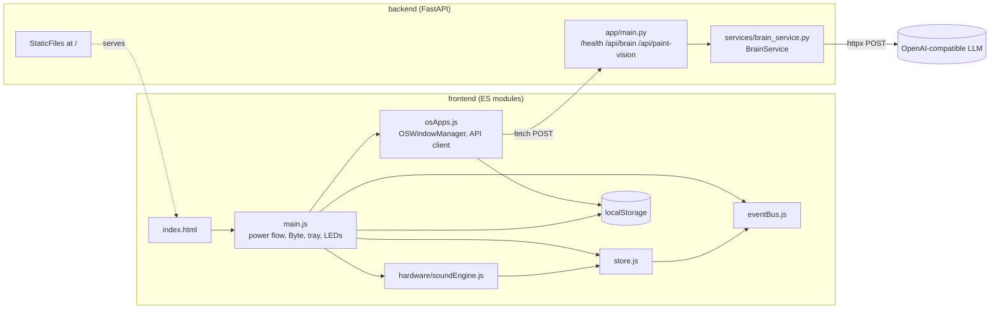
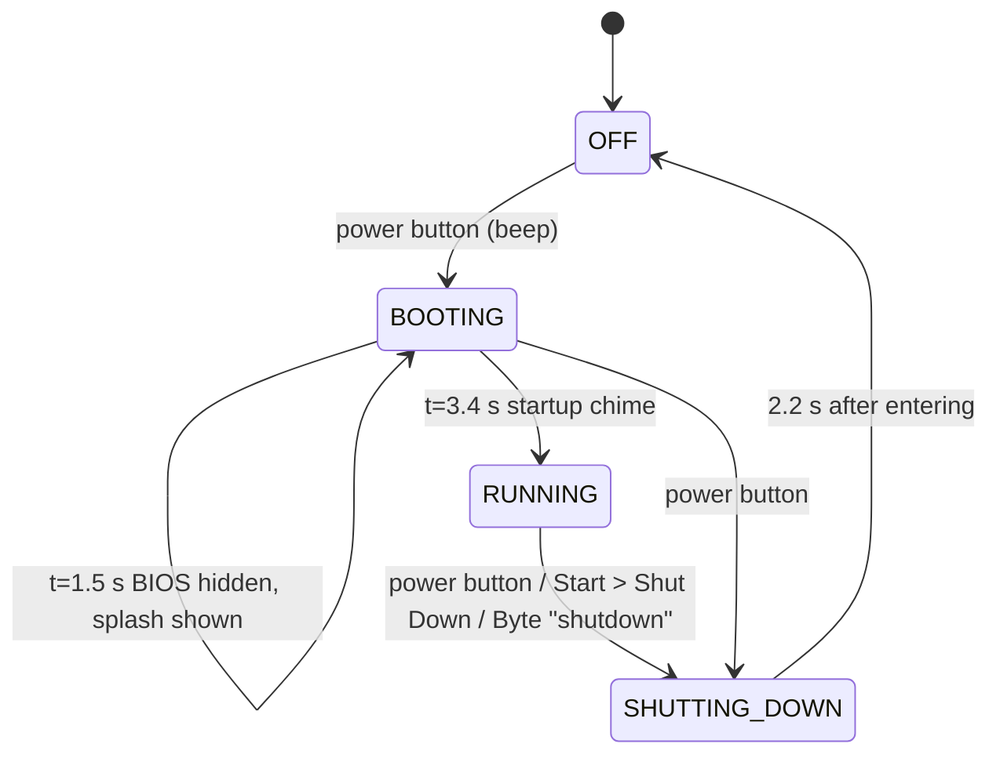
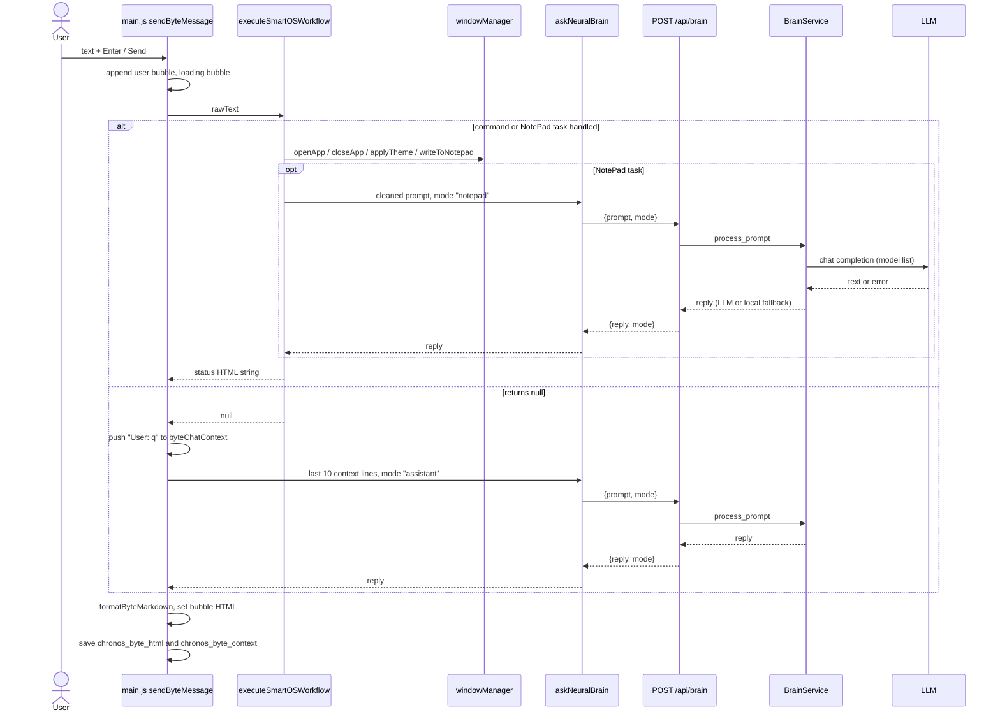
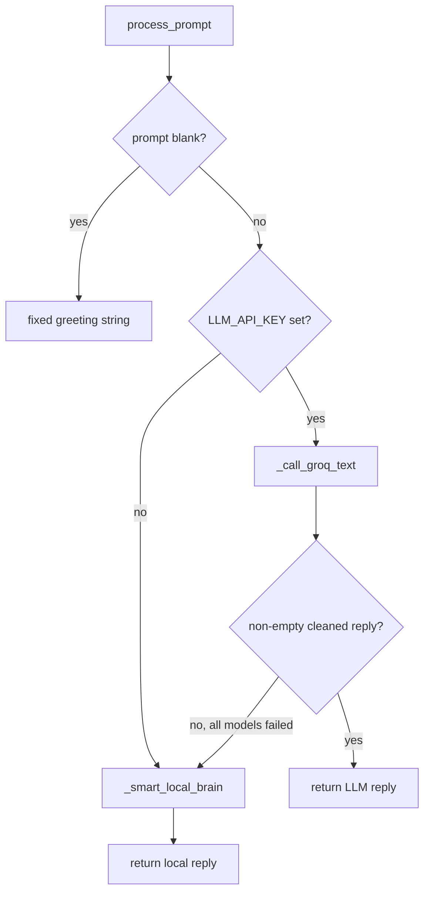

# Design Document

## Overview

Chronos 95 is a browser-based retro desktop simulation. The frontend is Vanilla HTML5, CSS3 and ES modules with no framework. It draws a CRT monitor, a PC tower, a 104-key on-screen keyboard and a mouse, and runs a Windows-95-style desktop inside the CRT screen. The backend is a FastAPI service ("Chronos 95 Neural Backend", version 1.95.0) that returns AI replies for the assistant Byte and for the Explorer, NotePad and PixelPaint apps. It can also serve the frontend directory as static files.

This document describes the code as built. The frontend has no build step, no bundler and no test suite. The backend has one Hypothesis test.

Design decisions:

- **Power state in a store, notifications on an event bus.** `store.js` owns power, audio and lock state. It emits events through `eventBus.js`. `main.js` subscribes and updates the DOM.
- **One window manager class for all apps.** `OSWindowManager` in `osApps.js` creates windows from a config object returned by `getAppConfig(appId)`. Each config has an `onMount` callback that wires the app's DOM. There are no per-app modules.
- **Commands before AI.** Byte text goes through `executeSmartOSWorkflow`, which uses regex and keyword matching. Only unhandled text is sent to the LLM.
- **LLM with local fallback.** `BrainService` tries a list of models in order and falls back to a local text routine, so the HTTP endpoints always return a reply string.

## Architecture

### Module structure

Files that exist:

```
frontend/index.html
frontend/css/hardware.css, os-shell.css
frontend/js/core/main.js, osApps.js, store.js, eventBus.js
frontend/js/core/hardware/soundEngine.js
frontend/js/apps/   (empty)
frontend/js/ui/     (empty)
backend/app/main.py
backend/app/services/brain_service.py
backend/app/tests/test_brain_pbt.py
backend/Dockerfile, backend/requirements.txt
docker-compose.yml
```



`main.js` imports `eventBus`, `store`, `PowerState`, `soundEngine`, and from `osApps.js` the `windowManager`, `askNeuralBrain`, `askPaintVision` and `formatByteMarkdown` exports. `soundEngine.js` imports `store`. `store.js` imports `eventBus`.

### Power lifecycle



Details:

- The BIOS screen is visible as soon as BOOTING is entered (`POWER_STATE_CHANGED` handler).
- The splash screen swap at 1.5 s is done directly in a timer callback in `main.js`. It does not go through the store.
- The power button handler clears pending boot timers on every press. If the state is OFF it boots. Otherwise it calls `triggerGracefulShutdown()`.
- A button press while SHUTTING_DOWN calls `triggerGracefulShutdown()` again. That clears the pending OFF timer and starts a new 2.2 s timer.
- Sign Out does not change power state. It closes all windows, hides the desktop and shows the login dialog. OK on the dialog plays the startup chime and shows the desktop.

### Byte message flow



Order of checks inside `executeSmartOSWorkflow(rawText)`:

1. `clear chat` / `clear history`: reset context and remove both Byte localStorage keys.
2. Compute `isNotepadTask` from NotePad keywords, write verbs and format words, or the prefixes `append `, `add to note`, `save to note`.
3. If not a NotePad task: `close all` / `reset desktop`, then per-app close, minimize, maximize and open keywords for paint, explorer, notepad and settings.
4. NotePad task: strip "to/in notepad" and "save it" phrases, optionally add up to 2500 characters of browser text, call `askNeuralBrain(prompt, 'notepad')`, then `windowManager.writeToNotepad(reply, true)`.
5. Canvas wording (`draw`, `canvas`, `colour`, `color`, `sketch`) while PixelPaint is open: `askPaintVision`.
6. `search ` / `browse ` prefix: open Explorer and run its search.
7. Theme keywords `matrix`, `sunset`, `space`, `teal`; `mute`, `unmute`; `shut down`, `shutdown`, `turn off` (shutdown runs after a 600 ms timeout).
8. Otherwise return `null`.

## Components and Interfaces

### eventBus.js

```js
class EventBus {
  on(eventName: string, callback: (data) => void): void
  emit(eventName: string, data?: any): void   // callbacks run in subscription order
}
export const eventBus: EventBus
```

There is no unsubscribe and callbacks are not wrapped in error handling.

### store.js

```js
export const PowerState = { OFF, BOOTING, RUNNING, SHUTTING_DOWN } // string values equal the names
class Store {
  getState(): State
  setPowerState(newPowerState): void            // emits POWER_STATE_CHANGED with the state string
  setVolume(vol: number, muted = state.muted): void // clamps vol to [0,1]; emits AUDIO_STATE_CHANGED
  setLocks(locksObj: Partial<Locks>): void      // merges; emits LOCKS_CHANGED with the full locks object
}
export const store: Store
```

Events:

| Event | Payload | Subscriber effect in `main.js` |
|---|---|---|
| `POWER_STATE_CHANGED` | `PowerState` string | Resets CRT classes, hides all stages and popups, sets the PWR LED, shows the stage for the new state |
| `AUDIO_STATE_CHANGED` | `{volume, muted, effectiveVolume}` | Sets the volume label (`NN%` or `MUTED`) and the tray icon (🔇 if muted or 0, 🔉 under 50, 🔊 otherwise) |
| `LOCKS_CHANGED` | `{num, caps, scroll}` | Toggles `on` on `#led-num`, `#led-caps`, `#led-scroll` |

### hardware/soundEngine.js

```js
class SoundEngine {
  init(): void                          // lazy AudioContext, resumes if suspended
  getEffectiveGain(baseGain): number    // 0 if muted or volume <= 0, else baseGain * volume
  playBiosBeep(): void                  // base 0.1, 950 Hz square, 0.18 s
  playStartupChime(): void              // base 0.07, 5 sine notes (261.63 ... 587.33 Hz), 80 ms apart, stops at 2.9 s
  playKeyClick(): void                  // base 0.045, triangle 180 to 40 Hz, 25 ms; needs an existing ctx
}
export const soundEngine: SoundEngine
```

`playBiosBeep` and `playStartupChime` return before creating a context when the effective gain is 0.

### osApps.js

Exports:

```js
export const windowManager: OSWindowManager
export async function askNeuralBrain(prompt: string, mode = 'assistant'): Promise<string>
export async function askPaintVision(imageBase64: string, prompt: string): Promise<string>
export function formatByteMarkdown(text: string): string  // **x** -> <b>x</b>, `x` -> <code>x</code>, \n -> <br/>
```

`API_BASE` is `''` when `location.port === '8000'` or the hostname is not `localhost`/`127.0.0.1`. Otherwise it is `http://localhost:8000`.

`askNeuralBrain` posts `{prompt, mode}` to `/api/brain` and returns `data.reply`. On a non-OK response or a thrown error it returns `"[FastAPI Offline] Make sure uvicorn is running on port 8000!"`.

`askPaintVision` posts `{image_base64, prompt}` to `/api/paint-vision`. On a non-OK response or a thrown error it returns `askNeuralBrain(prompt, 'assistant')`.

`OSWindowManager`:

```js
class OSWindowManager {
  zIndexCounter = 10; openWindows: {[appId]: HTMLElement}
  lastBrowserText: string; lastBrowserTitle: string

  init(): void                              // caches #window-layer, #taskbar-tabs; applies saved theme
  applyTheme(themeClass): void              // swaps class on #os-desktop; writes chronos_theme
  openApp(appId): HTMLElement | null        // existing window: restore + focus; unknown id: null
  focusWindow(appId): void                  // un-minimize, z-index = ++counter, re-render tabs
  minimizeApp(appId): void
  toggleMaximize(appId): void
  closeApp(appId): boolean
  closeAll(): void
  getBrowserText(): string                  // #exp-viewport text if Explorer open, else lastBrowserText
  writeToNotepad(newContent, append = true): void
  getCanvasDataUrl(): string | null         // PNG data URL of #paint-canvas if PixelPaint open
  renderTaskbarTabs(): void
  makeDraggable(winEl, handleEl, appId): void
  makeResizable(winEl, appId): void         // 8 handles, min 260 x 170
  getAppConfig(appId): AppConfig | undefined
  mountPaintLogic(win): void
}
```

Windows use `<div class="os-window">` with a title bar (`_`, `□`, `✕` buttons), a body, and eight `.rz-handle` elements. Drag and resize listeners are added to `window` on each window creation and are not removed when the window closes.

`writeToNotepad(text, append)` trims the new text and returns without doing anything if it is empty. It opens NotePad, reads the current text from `#np-text` (or `chronos_notepad` if the textarea is missing), and writes `existing + "\n\n" + new` when appending to non-empty text, otherwise just the new text. It saves to `chronos_notepad` and sets the status to "Appended & Saved ✓".

App configs (`getAppConfig`):

| appId | Title | Size | Notes |
|---|---|---|---|
| `explorer` | 🌍 Chronos Explorer | 510x340 | Tabs, Home, Go, "📝 +NotePad"; `win.runExplorerSearch` is attached for Byte |
| `notepad` | 📝 NotePad.exe | 435x305 | `#np-text`, Undo (one level), Clear, "✨ Write / Enhance with Byte" |
| `paint` | 🎨 PixelPaint.exe | 515x355 | 405x255 canvas, brush, eraser, line, rect, circle, fill, size 1-28, 8 swatches, "👁️ Ask Byte" |
| `settings` | ⚙️ Display & Personalization | 320x220 | Four `data-theme` buttons |

Explorer behavior: tab titles are cut to 12 characters in the tab bar. A search sets the address to the query when it starts with `http`, otherwise to `http://chronos.net/` + the lowercase query with runs of non-alphanumerics replaced by `-`. `welcome.com` and `http://welcome.com` show the built-in portal. Other queries call `askNeuralBrain(q, 'browser')` and insert the reply as HTML into the viewport. Clicking a link searches its `data-search` value or its text.

### main.js

Key functions:

```js
triggerGracefulShutdown(): void
getByteChatContainer(): HTMLElement          // loads chronos_byte_html on first call
ensureGreetingBanner(), showBootGreeting(), openFullChatLog(), closeByteBubble(): void
saveByteMemory(container): void              // chronos_byte_html + last 20 context lines
async executeSmartOSWorkflow(rawText): Promise<string | null>
async sendByteMessage(): Promise<void>
syncLockLeds(e: KeyboardEvent): void         // reads getModifierState for NumLock, CapsLock, ScrollLock
renderCalendar(), updateLiveClock(): void
```

Other wiring: desktop icons and Start items with `data-open`, Start toggle, Sign Out, login OK, tray popups (only one open at a time), Wi-Fi toggle, volume slider and mute checkbox, clock (1 s interval), mouse parallax (`±42.5 px`, `±22.5 px`), mouse button highlight, and key highlight by `data-code`.

Boot greeting: on RUNNING the bubble is shown without the `expanded` class and hidden after 5 s unless the input has focus or the chat is expanded.

### localStorage keys

| Key | Written by | Content |
|---|---|---|
| `chronos_theme` | `applyTheme` | One of `theme-teal`, `theme-matrix`, `theme-sunset`, `theme-space` |
| `chronos_notepad` | NotePad input, Clear, Undo, AI, `writeToNotepad` | Full NotePad text |
| `chronos_byte_html` | `saveByteMemory`, paint-vision handler | `innerHTML` of the Byte chat history |
| `chronos_byte_context` | `saveByteMemory` | JSON array of the last 20 context lines |

### Backend

`app/main.py`:

```python
GET  /health            -> {"status": "online", "os": "Chronos 95", "engine": "FastAPI Neural Bridge"}
POST /api/brain         body BrainRequest        -> {"reply": str, "mode": str}
POST /api/paint-vision  body PaintVisionRequest  -> {"reply": str}
mount "/" StaticFiles(directory=<repo>/frontend, html=True)   # only if the directory exists
```

CORS allows all origins, methods and headers, with credentials. The static mount is registered last so the API routes take precedence.

`BrainService` (`brain_service.py`, singleton `brain_service`):

```python
class BrainService:
    def _get_config(self) -> tuple[str, str, str]   # (api_key, api_url, model)
    async def process_prompt(self, prompt: str, mode: str = "assistant") -> str
    def _clean_llm_output(self, text: str, mode: str) -> str
    async def _call_groq_text(self, prompt, mode, api_key, api_url, env_model) -> str  # "" on failure
    def _smart_local_brain(self, prompt: str, mode: str) -> str
    async def analyze_canvas_image(self, image_base64: str, prompt: str) -> str
```

`_get_config` loads `backend/.env`, or the repo-root `.env` if the first is missing, with `override=True`. It reads `LLM_API_KEY` (whitespace and quotes stripped), `LLM_API_URL` (default `https://api.groq.com/openai/v1/chat/completions`) and `LLM_MODEL` (default `llama-3.3-70b-versatile`). It is called on every request.

### Dual-engine flow in BrainService



Text engine (`_call_groq_text`):

- Model list, in order, without duplicates and skipping empty values: `llama-3.3-70b-versatile`, `llama-3.1-8b-instant`, `LLM_MODEL`, `openai/gpt-oss-120b`, `openai/gpt-oss-20b`.
- One `httpx.AsyncClient(timeout=22.0)` is shared by the loop. The timeout applies per request.
- Payload: system prompt by mode, user prompt, `temperature` 0.5 for `notepad` and 0.65 otherwise, `max_tokens` 900.
- For each model: a 200 response with non-empty cleaned content is returned. A non-200 status, an exception or empty content moves on to the next model.
- System prompts: `browser` (Explorer HTML using `web-article`, `web-hero`, `web-grid`, `web-card`, links with `data-search`), `notepad` (direct text only), `assistant` (Byte). Unknown modes use `assistant`.
- `_clean_llm_output` removes `<think>...</think>` blocks, strips `` ```html `` and `` ``` `` fences for `browser`, and drops a leading and trailing fence line for `notepad`.

Local engine (`_smart_local_brain`):

- `notepad`: reads a limit from the first `N pointer|point|bullet|step|line|item` match (default 5). Uses the text after `REFERENCE WEBPAGE CONTENT:` if present. Splits on sentence ends and newlines, keeps fragments longer than 15 characters that do not start with `USER INSTRUCTION`, takes the first `limit`, and returns them as `• ` lines. If no fragment qualifies it returns the whole prompt as one bullet.
- Any other mode: `"Processed your request!"`.

Vision engine (`analyze_canvas_image`):

- Takes the part of `image_base64` after the last comma.
- With a key and image data: tries `meta-llama/llama-4-scout-17b-16e-instruct`, `meta-llama/llama-4-maverick-17b-128e-instruct`, `llama-3.2-11b-vision-preview` with `timeout=20.0`, `temperature` 0.6 and `max_tokens` 350. The first 200 response is returned stripped.
- If every vision model fails it calls `process_prompt` with a color-advice prompt in mode `assistant`.
- With no key or no image data it returns the fixed tip that suggests `#FF6B35` and `#FFD166`.

### Deployment

- `backend/Dockerfile`: `python:3.11-slim`, workdir `/code`, installs `requirements.txt`, copies `./app`, exposes 8000, runs `uvicorn app.main:app --host 0.0.0.0 --port 8000`. The frontend is not copied into the image.
- `docker-compose.yml`: service `chronos-backend`, build `./backend`, port `8000:8000`, `env_file: ./backend/.env`, `restart: unless-stopped`.
- `requirements.txt`: fastapi 0.115.0, uvicorn[standard] 0.30.6, pydantic 2.9.2, python-dotenv 1.0.1, httpx 0.27.2, pytest 8.3.3, hypothesis 6.112.1.

## Data Models

### Store state

```ts
interface State {
  power: 'OFF' | 'BOOTING' | 'RUNNING' | 'SHUTTING_DOWN'; // initial 'OFF'
  volume: number;   // 0..1, initial 0.8
  muted: boolean;   // initial false
  locks: { num: boolean; caps: boolean; scroll: boolean }; // initial { true, false, false }
}
```

### App config

```ts
interface AppConfig {
  title: string;
  width: string;    // CSS, e.g. '510px'
  height: string;
  left: string;
  top: string;
  html: string;                       // window body markup
  onMount: (win: HTMLElement) => void;
}
```

### Window manager state

```ts
openWindows: { [appId: string]: HTMLElement }   // at most one window per appId
zIndexCounter: number                            // starts at 10, incremented on open and focus
```

### Byte chat context

`byteChatContext: string[]` holds lines of the form `User: ...` and `Byte: ...`. `localStorage.chronos_byte_context` stores `JSON.stringify(byteChatContext.slice(-20))`. The prompt for the assistant is `byteChatContext.slice(-10).join('\n')`.

### Request models (backend)

```python
class BrainRequest(BaseModel):
    prompt: str = Field(..., max_length=8000)
    mode: str = Field(default="assistant")

class PaintVisionRequest(BaseModel):
    image_base64: str = Field(..., max_length=2_500_000)
    prompt: str = Field(default="Analyze this drawing", max_length=2000)
```

### Response shapes

```json
// GET /health
{ "status": "online", "os": "Chronos 95", "engine": "FastAPI Neural Bridge" }
// POST /api/brain
{ "reply": "<string>", "mode": "<echo of request mode>" }
// POST /api/paint-vision
{ "reply": "<string>" }
// Validation failure (FastAPI default)
{ "detail": [ { "loc": [...], "msg": "...", "type": "..." } ] }   // HTTP 422
```

## Correctness Properties

*A property is a characteristic or behavior that should hold true across all valid executions of a system-essentially, a formal statement about what the system should do. Properties serve as the bridge between human-readable specifications and machine-verifiable correctness guarantees.*

Only properties that hold for the current code are listed. Property 1 is the only one already verified by an automated test. The others are statements about the current code that no test checks yet.

### Property 1: Brain service always returns a non-empty string (verified by `test_brain_pbt.py`)

For any prompt string of 0 to 500 characters and any mode in `browser`, `notepad`, `assistant`, `unknown`, `process_prompt` returns a `str` of length greater than 0.

**Validates: Requirements 21.1, 21.2**

This property holds because blank prompts return the fixed greeting, LLM replies are only returned when non-empty after cleaning, and the local fallback returns non-empty text for every input except a `notepad` prompt that asks for `0` items (for example "0 points"). That case yields an empty string from `_smart_local_brain`, and the existing generator is unlikely to produce it.

### Property 2: Blank prompts get the fixed greeting

For any string made only of whitespace characters and any mode, `process_prompt` returns "Hey! Tell me what you'd like to open, write, draw, or search." without contacting the LLM.

**Validates: Requirements 19.2**

### Property 3: Model candidate list is ordered and unique

For any value of `LLM_MODEL`, the candidate list used by `_call_groq_text` starts with `llama-3.3-70b-versatile`, `llama-3.1-8b-instant`, contains no duplicates and no empty entries, and ends with `openai/gpt-oss-120b`, `openai/gpt-oss-20b` (minus any of these already present earlier).

**Validates: Requirements 19.7**

### Property 4: Cleaning removes reasoning blocks

For any text and any mode, `_clean_llm_output` returns a string that contains no `<think>...</think>` block, and applying it a second time with the same mode returns the same string.

**Validates: Requirements 19.10**

### Property 5: Local notepad fallback respects the requested bullet count

For any prompt in mode `notepad` that asks for `N` items with `N >= 1` using one of the supported words (pointer, point, bullet, step, line, item), `_smart_local_brain` returns at most `N` lines, and every line starts with "• ". Without such a phrase it returns at most 5 lines.

**Validates: Requirements 19.12, 19.13**

### Property 6: Local fallback in other modes is constant

For any prompt and any mode other than `notepad`, `_smart_local_brain` returns "Processed your request!".

**Validates: Requirements 19.15**

### Property 7: Oversized request fields are rejected

For any `prompt` longer than 8000 characters sent to `/api/brain`, or any `image_base64` longer than 2,500,000 characters or `prompt` longer than 2000 characters sent to `/api/paint-vision`, the response status is 422. For any valid body, the status is 200 and the body has the documented keys.

**Validates: Requirements 18.4, 18.5, 18.6, 18.7, 18.8**

### Property 8: Event bus delivers in subscription order

For any event name and any sequence of subscribed callbacks, `emit(name, data)` calls every callback for that name exactly once, in subscription order, with `data`, and calls no callback of another name.

**Validates: Requirements 1.1**

### Property 9: Volume is clamped and effective volume honors mute

For any number `v` and any `muted` flag, after `setVolume(v, muted)` the state volume equals `min(1, max(0, v))`, and the emitted `effectiveVolume` equals 0 when muted and the clamped volume otherwise.

**Validates: Requirements 1.4**

### Property 10: Lock updates merge

For any current locks and any partial locks object, after `setLocks` the state locks equal the current locks overridden by the given keys, and the emitted payload equals the state locks.

**Validates: Requirements 1.5**

### Property 11: Power state is stored and announced

For any `PowerState` value, after `setPowerState(s)` the state power equals `s` and `POWER_STATE_CHANGED` was emitted with `s`.

**Validates: Requirements 1.3**

### Property 12: Sound gain scales with volume and silences on mute

For any base gain `g > 0`, volume `v` in [0, 1] and muted flag, `getEffectiveGain(g)` equals 0 when muted or `v <= 0`, and `g * v` otherwise.

**Validates: Requirements 2.4, 2.5**

### Property 13: Theme persistence round trip

For any of the four theme classes, after `applyTheme(t)` the key `chronos_theme` equals `t`, and a new `init()` applies `t` to `#os-desktop`.

**Validates: Requirements 9.4, 9.5**

### Property 14: Opening an app twice keeps one window and focuses it

For any known `appId` and any sequence of `openApp(appId)` calls, `openWindows` holds exactly one window for that id, and after each call that window has the highest z-index and is not minimized.

**Validates: Requirements 10.2, 10.8**

### Property 15: closeAll empties the window set

For any set of open windows, after `closeAll()` `openWindows` has no keys, and `closeApp(id)` returns `true` only for an id that was open.

**Validates: Requirements 10.9, 10.10**

### Property 16: NotePad append preserves existing text

For any existing NotePad text and any new text that is non-blank after trimming, `writeToNotepad(new, true)` leaves `chronos_notepad` equal to `trim(existing) + "\n\n" + trim(new)` when the trimmed existing text is non-empty, and to `trim(new)` otherwise. For a blank `new`, nothing changes.

**Validates: Requirements 16.3, 10.11**

### Property 17: Markdown formatting leaves no raw newlines

For any string, `formatByteMarkdown` returns a string with no `\n` characters, and every `**x**` pair becomes `<b>x</b>`.

**Validates: Requirements 15.9**

### Property 18: Explorer address is a slug

For any query that does not start with `http`, the active tab address matches `^http://chronos\.net/[a-z0-9-]*$`.

**Validates: Requirements 11.7**

### Property 19: Window resize respects the minimum size

For any resize drag on a non-maximized window, the resulting width is at least 260 px and the resulting height is at least 170 px.

**Validates: Requirements 10.7**

## Error Handling

As built:

- **LLM request failures.** A non-200 status, a network exception, a malformed JSON body, or empty content makes `_call_groq_text` try the next model. All exceptions inside the loop are swallowed with `except Exception: continue`. If every model fails the result is `""` and `process_prompt` uses the local fallback.
- **Vision failures.** Same pattern with three vision models, then a text request through `process_prompt` in mode `assistant`.
- **Missing key.** No LLM call is made. Text requests use the local fallback and vision requests return the fixed color tip.
- **Blank prompt.** `process_prompt` returns the fixed greeting before reading any configuration.
- **Invalid request bodies.** FastAPI and Pydantic answer with 422. There is no custom exception handler.
- **Unhandled backend exceptions.** `process_prompt` and `analyze_canvas_image` do not catch errors outside the LLM loops (for example a failure in `_get_config`). Those would surface as HTTP 500.
- **Local fallback edge case.** A `notepad` prompt that asks for `0` items produces an empty reply.
- **Frontend network failures.** `askNeuralBrain` returns the "[FastAPI Offline] ..." text. `askPaintVision` falls back to `askNeuralBrain`. Neither throws, so a failed call shows up as a normal chat or page reply.
- **Frontend state errors.** `openApp` returns `null` for an unknown id. `closeApp` returns `false` for a window that is not open. `writeToNotepad` ignores blank text. The store does not validate power transitions.
- **Missing DOM nodes.** Byte and paint code check for the bubble and history elements and return early when they are missing.
- **Event bus.** A throwing subscriber stops the remaining subscribers of that emit, because callbacks are not wrapped.

## Testing Strategy

### Existing test

`backend/app/tests/test_brain_pbt.py` contains one Hypothesis test, `test_brain_service_never_crashes_on_arbitrary_input`. It generates `prompt = st.text(min_size=0, max_size=500)` and `mode` from `["browser", "notepad", "assistant", "unknown"]`, runs `asyncio.run(brain_service.process_prompt(prompt, mode))`, and asserts the result is a `str` with length greater than 0. It uses Hypothesis defaults (100 examples). It does not carry a feature-tag comment.

Run from `backend/`:

```
pytest app/tests
```

Network note: `process_prompt` reads `backend/.env` on every call. When `LLM_API_KEY` is set, each generated non-blank example sends real requests to `LLM_API_URL`, with up to five models at 22 seconds each. The test is then slow, depends on the network and can use API quota. With no key set it only exercises the local fallback. Hypothesis may also report a deadline problem in the keyed case.

### Gaps in automated coverage

- There is no frontend test suite. Properties 8 to 19 are not covered by tests.
- There are no tests of the FastAPI endpoints (Property 7) or of the BrainService internals (Properties 2 to 6).
- `backend/tests/` contains only `.gitkeep`.

### Approach for new tests

Property-based testing applies to the pure logic: `_clean_llm_output`, `_smart_local_brain`, the candidate list, the store, the event bus, `getEffectiveGain`, `formatByteMarkdown` and the Explorer slug. A property-based library must be used (Hypothesis for Python; fast-check would fit the JS modules). Each property should run at least 100 iterations and be tagged `Feature: chronos-95-retro-os, Property N: <title>`.

Example-based tests fit the rest:

- Boot and shutdown timers (1.5 s, 3.4 s, 2.2 s) with fake timers.
- `askNeuralBrain` and `askPaintVision` fallbacks with a mocked `fetch`.
- `/health`, `/api/brain` and `/api/paint-vision` with FastAPI `TestClient`, with `brain_service` mocked.
- `BrainService` model fallthrough with a mocked `httpx.AsyncClient`.

UI rendering (hardware rig, CSS, window layout, tray popups, paint tools) is not suited to property tests. It would be covered by manual checks or screenshot tests, and none exist.

## Known gaps

These notes are not requirements. They match the "Known gaps" in `requirements.md`.

- The assistant is named Byte, but the steering file names it Chippy.
- Window and app logic sits in `osApps.js` and `main.js` and touches the DOM directly. It is not split into separate `notepadApp.js` and `paintApp.js` plugin modules.
- The Explorer welcome portal has a link label that contains a prohibited trademark string ("Linux vs ... 95 Architecture").
- CORS allows all origins.
- There is no `.env.example`.
- The container runs as root, has no health check and does not include the frontend.
- The property-based test can make network calls when a key is set in `.env`.
- The Store does not validate power state transitions.
- Byte replies are inserted with `innerHTML`.
- The Event_Bus has no unsubscribe and no error handling around callbacks.
